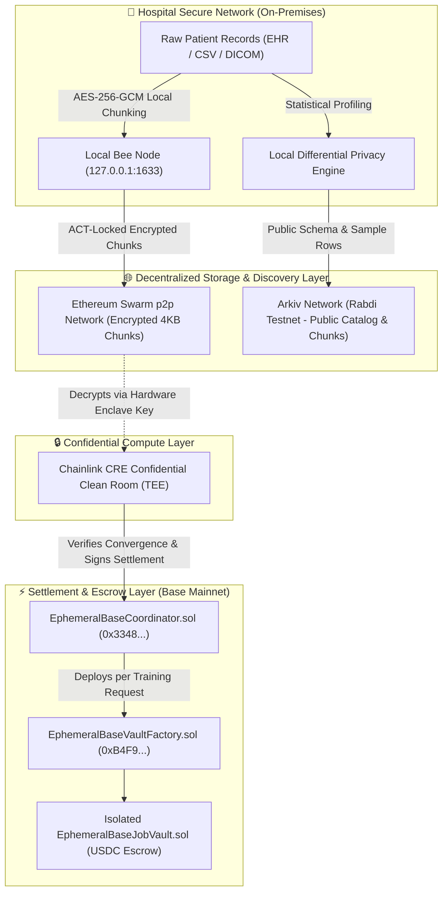

# Ephemeral · Confidential Healthcare AI Clean Room & Marketplace

> **Better models. Better care. Built on trust.**\
> A zero-trust, privacy-preserving healthcare AI clean room and decentralized dataset marketplace connecting hospitals, AI researchers, and confidential compute enclaves.

---

## 🏆 ETHGlobal Mumbai Track Submissions

### 1. 🧩 Partner Track: Build on Arkiv (from scratch) — $4,000
Ephemeral uses **Arkiv Rabdi Testnet** (`chainId: 7794095`) to store, index, and query public clinical research datasets with SQL-like filters, cryptographic publisher ownership, and protocol-native expiration.

* **Publishing / Entity Writer Wallet Address:** `0x30411b981578Fad62D4D20316Da8936cE61F8509`
* **Arkiv Documentation Dossier:**
  * 📋 [**/arkiv/schema.md**](file:///E:/Ephemeral/arkiv/schema.md): Entity definitions (`PublicDatasetCatalog`, `PublicDatasetChunks`), indexed fields, ownership model, and 365-day expiration policy.
  * ⚙️ [**/arkiv/friction.md**](file:///E:/Ephemeral/arkiv/friction.md) (25% judging weight): Concrete developer feedback on `@arkiv-network/sdk`, Rabdi access key ergonomics, and multi-part chunking.
  * 🌍 [**/arkiv/reach.md**](file:///E:/Ephemeral/arkiv/reach.md) (25% judging weight): Target audience (academic medical centers, AI labs), live usability, and post-hackathon roadmap.
  * 🔒 [**/arkiv/why-arkiv.md**](file:///E:/Ephemeral/arkiv/why-arkiv.md) (25% judging weight): Why Postgres fails for medical data custody, and what we intentionally kept off Arkiv (encrypted PHI on Swarm).
  * 💻 [**/arkiv/how-you-use-arkiv.md**](file:///E:/Ephemeral/arkiv/how-you-use-arkiv.md) (25% judging weight): How SQL-like filtering powers marketplace cards, schema previews, and client-side chunk downloads.

#### 🧪 Runnable Arkiv Query for Judges
Judges can verify and query Ephemeral's entities directly on Rabdi testnet using `@arkiv-network/sdk`:

```ts
import { createPublicClient } from '@arkiv-network/sdk';
import { rabdi } from '@arkiv-network/sdk/chains';
import { http } from 'viem';
import { PublicDatasetCatalog } from './frontend/src/arkiv/schema';

const client = createPublicClient({ chain: rabdi({ accessKey: "" }), transport: http() });

// Fetch active clinical research datasets published by Ephemeral
const result = await client
  .select({
    $key: true,
    datasetKey: true,
    title: true,
    category: true,
    institution: true,
    records: true,
    license: true,
  })
  .from(PublicDatasetCatalog)
  .ownedBy('0x30411b981578Fad62D4D20316Da8936cE61F8509')
  .limit(10)
  .fetch();

console.log('Queried Arkiv Datasets:', result.entities);
```

---

### 2. 🐝 Bonus Track: Arkiv + Swarm Bonus (from scratch) — $500
Ephemeral simultaneously uses **Arkiv** (for public dataset catalog indexing and synthetic schema discovery) and **Ethereum Swarm** (for decentralized storage of confidential patient records behind Swarm Access Control Triad / ACT).

* 📖 Complete Bonus Specification: [**/arkiv/swarm.md**](file:///E:/Ephemeral/arkiv/swarm.md)
  * Data division: Public schemas on Arkiv, encrypted clinical cohorts on Swarm.
  * Live Arkiv entity key: `0x30411b981578fad62d4d20316da8936ce61f8509000000000000000000000001`
  * Swarm synthetic schema reference: `953239291f2f0462bcd571c4d9861095411a47d7ef77ce808c5c67d8ce7d2762`
  * Active postage batch ID: `5a63c224ed75f8fac7fec10e3efa39e646744b41f263e222c104a8cf5dfd34e6`
  * Buyer & Deployer Wallet: `0xc76200A61295FDDAFd4cC524a074EF8bA69Ca232`

---

## 🌐 Live Production Deployments

| Component | Network / Protocol | Address / URL | Status |
| :--- | :--- | :--- | :--- |
| **Decentralized DApp** | **Ethereum Swarm / ENS** | [ephemeralglobal.eth.limo](https://ephemeralglobal.eth.limo/app/) | 🟢 **Live HTTP 200** |
| **Swarm Feed Manifest** | **Swarm Mainnet (Gnosis)** | `98ef26ded1419c0659b8a67e9da5f9033157000f5662204e7c99759046365e01` | 🟢 **Feed Index 12** |
| **Coordinator Contract** | **Base Mainnet (8453)** | [`0x3348145B791245E149Efe0BD9d7f74B69191714a`](https://basescan.org/address/0x3348145B791245E149Efe0BD9d7f74B69191714a) | 🟢 **Verified** |
| **Vault Factory** | **Base Mainnet (8453)** | [`0xB4F9aCA56DE3e757f2720dF058cE6C8aEea925f0`](https://basescan.org/address/0xB4F9aCA56DE3e757f2720dF058cE6C8aEea925f0) | 🟢 **Verified** |
| **Payment Token** | **Circle USDC (Base)** | [`0x833589fCD6eDb6E08f4c7C32D4f71b54bdA02913`](https://basescan.org/token/0x833589fCD6eDb6E08f4c7C32D4f71b54bdA02913) | 🟢 **Native USDC** |
| **Public Dataset Index** | **Arkiv Rabdi Testnet** | Entity: `0x3041...0001` (`chainId: 7794095`) | 🟢 **Queryable** |

---

## 🏗️ System Architecture



---

## 🤖 AI Usage Disclosure (ETHGlobal Compliance)

In accordance with ETHGlobal rules regarding AI usage:
* **AI Assistance:** AI coding assistants (Google Antigravity / Gemini) were utilized for rapid smart contract unit testing with Foundry, TypeScript interface generation for Wagmi v3 / Viem integration, and markdown documentation drafting.
* **Original Work:** All smart contract architectures (`EphemeralBaseCoordinator`, `EphemeralBaseJobVault`, `EphemeralBaseVaultFactory`), Chainlink CRE clean-room workflows, Swarm ACT encryption pipelines, and Arkiv chunk streaming algorithms were uniquely designed and built from scratch at ETHGlobal Mumbai.

---

## 📄 License
This project is licensed under the [MIT License](LICENSE).
